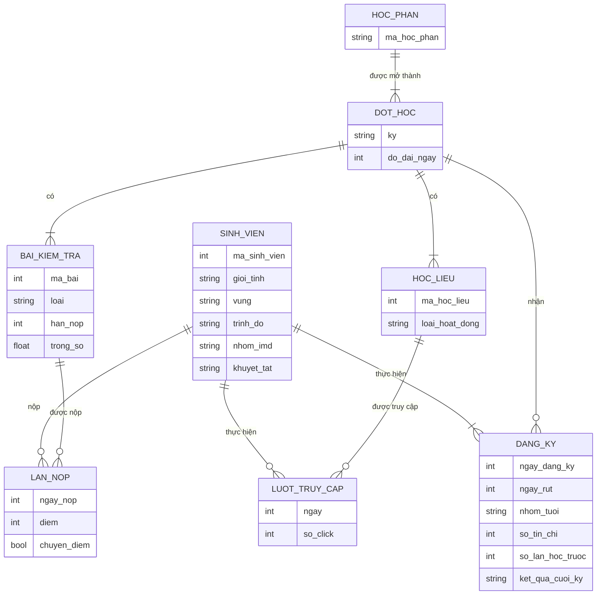
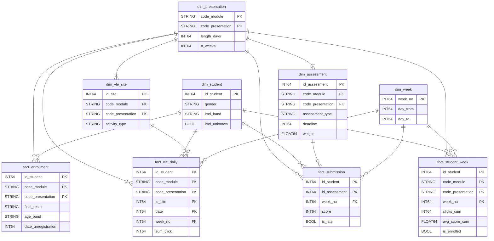

# Thiết kế cơ sở dữ liệu ở 3 mức: ý niệm, luận lý, vật lý

Tài liệu này đi qua 3 mức thiết kế của kho OULAD. Mỗi mức trả lời một câu hỏi khác nhau:

| Mức | Trả lời câu hỏi | Không quan tâm tới |
|---|---|---|
| Ý niệm | Nghiệp vụ có những thực thể nào, quan hệ với nhau ra sao? | Bảng, khóa, kiểu dữ liệu, hệ quản trị |
| Luận lý | Tổ chức thành bảng nào, cột nào, khóa nào, grain là gì? | Dữ liệu nằm trên đĩa thế nào, engine nào |
| Vật lý | Trên từng engine cụ thể, lưu và truy cập dữ liệu ra sao cho nhanh, rẻ? | |

Đi từ trên xuống: mức ý niệm lấy từ nghiệp vụ và 7 file CSV của OULAD; mức luận lý là star schema chốt trong
[contract.md](contract.md); mức vật lý là cách 9 bảng đó được lưu trên Parquet, BigQuery và PostgreSQL.

---

## 1. Mức ý niệm

### 1.1 Thực thể và quan hệ

| Thực thể | Ý nghĩa nghiệp vụ |
|---|---|
| Học phần | Một môn học, ví dụ AAA, BBB (7 học phần) |
| Đợt học | Một lần mở học phần trong một kỳ, ví dụ BBB 2014J (22 đợt). Mọi ngày trong dữ liệu tính từ ngày khai giảng của đợt |
| Sinh viên | Người học, có đặc điểm nhân khẩu học không đổi theo thời gian |
| Bài kiểm tra | Bài TMA (giảng viên chấm), CMA (máy chấm) hoặc Exam của một đợt |
| Học liệu | Một tài nguyên trên hệ thống học trực tuyến (VLE) của một đợt: trang nội dung, diễn đàn, quiz… |
| Đăng ký | Quan hệ nhiều-nhiều giữa Sinh viên và Đợt học, có thuộc tính riêng |
| Lần nộp | Quan hệ nhiều-nhiều giữa Sinh viên và Bài kiểm tra, có thuộc tính riêng |
| Lượt truy cập | Quan hệ nhiều-nhiều giữa Sinh viên và Học liệu theo ngày, có thuộc tính số click |

### 1.2 Quy tắc nghiệp vụ rút ra ở mức này

- Một sinh viên có thể đăng ký nhiều đợt, kể cả học lại cùng một học phần (`num_of_prev_attempts`).
- Một lượt đăng ký có thể bị rút giữa chừng, kể cả trước khai giảng (ngày rút ≤ 0).
- Bài kiểm tra và học liệu thuộc về đúng một đợt; cùng một mã học liệu không dùng lại giữa các đợt.
- Một sinh viên nộp mỗi bài tối đa một lần; bài có thể được chuyển điểm từ đợt trước (`is_banked`).

### 1.3 Quyết định quan trọng nhất ở mức ý niệm: thuộc tính nào thuộc về ai

File `studentInfo.csv` gộp chung hai thứ: thuộc tính của **sinh viên** và thuộc tính của **lượt đăng ký**. Mỗi
dòng của nó là sinh viên × đợt, không phải một sinh viên. Phân tích ở mức ý niệm tách ra:

| Thuộc tính trong `studentInfo` | Thuộc về | Lý do |
|---|---|---|
| giới tính, vùng, trình độ, nhóm IMD, khuyết tật | Sinh viên | Không đổi giữa các đợt (đã kiểm trên dữ liệu) |
| nhóm tuổi | **Đăng ký** | 72 sinh viên đổi nhóm tuổi giữa các lần đăng ký |
| số tín chỉ, số lần học trước, kết quả cuối kỳ | Đăng ký | Khác nhau theo từng đợt |

Quyết định này đi thẳng xuống mức luận lý: `dim_student` có 28.785 dòng (một sinh viên), còn `age_band` và
`final_result` nằm ở `fact_enrollment` (32.593 dòng). Nếu để nhóm tuổi ở sinh viên thì 72 người sẽ bị gán sai.

---

## 2. Mức luận lý

### 2.1 Từ ý niệm sang mô hình chiều

Kho phục vụ phân tích nên dùng mô hình chiều (Kimball) thay vì giữ nguyên mô hình quan hệ của nghiệp vụ.
Cách chuyển:

1. **Thực thể "danh từ" → dimension:** Đợt học (gộp luôn Học phần), Sinh viên, Bài kiểm tra, Học liệu. Thêm
   `dim_week` vì mọi câu hỏi nghiệp vụ đều theo tuần học.
2. **Quan hệ nhiều-nhiều có thuộc tính đo được → fact:** Đăng ký, Lần nộp, Lượt truy cập.
3. **Chọn grain cho từng fact:** khai báo một dòng là gì trước khi chọn cột.
4. **Thêm fact không có thực thể tương ứng** khi nghiệp vụ cần: `fact_student_week` là ảnh chụp tiến độ mỗi tuần,
   sinh ra cho cảnh báo sớm (BR4) và theo dõi tiến độ (BR7).

### 2.2 Sơ đồ luận lý (star schema dạng constellation)

Sơ đồ chỉ ghi các cột tiêu biểu; danh sách đủ cột, kiểu và định nghĩa từng cờ ở [contract.md](contract.md).

| Fact | Grain (một dòng là) | Loại fact | Số dòng |
|---|---|---|---:|
| `fact_enrollment` | sinh viên × đợt | accumulating snapshot: một dòng cho cả vòng đời lượt đăng ký | 32.593 |
| `fact_vle_daily` | sinh viên × đợt × học liệu × ngày | transaction, gộp theo ngày | 8.459.320 |
| `fact_submission` | sinh viên × bài | transaction | 173.912 |
| `fact_student_week` | sinh viên × đợt × tuần | periodic snapshot, as-of cuối tuần | 1.342.949 |

### 2.3 Các quyết định ở mức luận lý

| Quyết định | Lý do |
|---|---|
| Giữ khóa gốc của OULAD, không tạo khóa thay thế | Dữ liệu tĩnh, không có thay đổi theo thời gian cần lưu lịch sử; SQL và đáp án mẫu của cả nhóm dùng chung một bộ khóa |
| Gộp Học phần vào `dim_presentation` | Học phần chỉ có mã, không có thuộc tính riêng, tách ra là thêm một phép nối không cần thiết |
| Vấn đề dữ liệu thành cột cờ `BOOL`, không xóa dòng | Người phân tích tự chọn lọc hay giữ; số dòng vẫn đối soát được với nguồn |
| `fact_student_week` không có `final_result` | Chống rò rỉ nhãn: dữ liệu dùng để cảnh báo ở tuần `w` không được biết kết quả cuối kỳ |
| Bốn dấu hiệu nguy cơ BR4 tính lúc truy vấn, không lưu vào bảng | Ngưỡng (P25, điểm < 40) còn có thể đổi; lưu sẵn thì phải nạp lại kho mỗi lần đổi |

Ở cùng mức luận lý, TV3 dựng thêm hai bố trí khác của cùng dữ liệu để so với star: chuẩn hóa 3NF và bảng rộng
phi chuẩn hóa (xem [layouts.md](layouts.md)). So sánh các mô hình ở [data_models.md](data_models.md).

---

## 3. Mức vật lý

Cùng một mô hình luận lý được hiện thực trên 3 nơi lưu trữ, mỗi nơi một mục đích.

### 3.1 Kiểu dữ liệu

| Luận lý | Parquet (Spark) | BigQuery | PostgreSQL |
|---|---|---|---|
| Số nguyên (khóa, ngày, click) | `int` / `long` | `INT64` | `BIGINT` |
| Số thực (trọng số, điểm TB) | `double` | `FLOAT64` | `DOUBLE PRECISION` |
| Chuỗi (mã, loại) | `string` | `STRING` | `TEXT` |
| Cờ | `boolean` | `BOOL` | `BOOLEAN` |
| Ngày | số nguyên tương đối từ ngày khai giảng, giữ như nguồn | | |

### 3.2 Lưu trữ và kích thước

| Bảng | Parquet (nén snappy) | BigQuery | PostgreSQL: bảng | PostgreSQL: chỉ mục |
|---|---:|---:|---:|---:|
| `fact_vle_daily` | 42 MB | 516 MB | 816 MB | 952 MB* |
| `fact_student_week` | 6,1 MB | 124 MB | 172 MB | 64 MB |
| `fact_submission` | 1,0 MB | 11 MB | 17 MB | 5,4 MB |
| `fact_enrollment` | 0,5 MB | 3,0 MB | 4,4 MB | 1,3 MB |

\* gồm khóa chính và chỉ mục tối ưu `ix_fact_vle_daily_offering` (499 MB) của [optimization.md](optimization.md).

Cùng một bảng nhưng kích thước chênh 20 lần, vì cách lưu khác nhau:

- **Parquet** lưu theo cột và nén: cột lặp nhiều như `code_module` (7 giá trị) được mã hóa từ điển, gần như không
  tốn chỗ. Hợp làm kho trung gian và để DuckDB đọc tại máy.
- **BigQuery** cũng lưu theo cột, nhưng con số hiển thị và tính tiền là kích thước logic (chưa nén). Truy vấn chỉ
  đọc và tính tiền theo các cột được dùng.
- **PostgreSQL** lưu theo dòng: mỗi dòng mang đủ mọi cột kèm phần đầu dòng, không nén. Đổi lại, có chỉ mục B-tree
  để lấy nhanh một số ít dòng.

### 3.3 Ràng buộc, khóa và cách truy cập

| | Parquet | BigQuery | PostgreSQL |
|---|---|---|---|
| Khóa chính | Không có; kiểm bằng pytest (`test_primary_key_unique`) | Không ép buộc; kiểm bằng pytest trên Parquet | `PRIMARY KEY` thật cho 9 bảng |
| Khóa ngoại | Kiểm bằng pytest (`test_no_orphan_keys`) | Không có | Không khai báo (nạp lại từng bảng độc lập); kiểm bằng pytest |
| Tổ chức file / bảng | Một thư mục mỗi bảng, nhiều file `part-*.snappy.parquet` | Một bảng mỗi đối tượng trong dataset `oulad` | Một bảng mỗi đối tượng trong schema `public` |
| Tăng tốc truy vấn | Đọc theo cột, bỏ qua row group theo thống kê min/max | Phân vùng `RANGE_BUCKET(week_no)`, gom cụm theo module/kỳ, bảng tổng hợp sẵn | Chỉ mục B-tree, chỉ mục có `INCLUDE` để quét chỉ trên chỉ mục |
| Nạp | Spark ghi overwrite | Load job `WRITE_TRUNCATE` | `COPY` trong một transaction, rồi `ANALYZE` |

Số đo của các lựa chọn tăng tốc ở dòng 4 nằm ở [optimization.md](optimization.md).

---

## 4. Truy vết qua 3 mức

| Ý niệm | Luận lý | Vật lý (BigQuery / PostgreSQL) |
|---|---|---|
| Học phần + Đợt học | `dim_presentation` | 22 dòng, không cần tối ưu |
| Sinh viên | `dim_student` | Khóa chính `id_student` |
| Bài kiểm tra | `dim_assessment` | Khóa chính `id_assessment` |
| Học liệu | `dim_vle_site` | Khóa chính `id_site` |
| (thời gian theo tuần học) | `dim_week` | 43 dòng |
| Đăng ký | `fact_enrollment` | Khóa chính 3 cột |
| Lần nộp | `fact_submission` | Khóa chính (`id_student`, `id_assessment`) |
| Lượt truy cập | `fact_vle_daily`, gộp các lượt trùng trong ngày | Gom cụm theo module/kỳ (BigQuery); chỉ mục `(code_module, code_presentation, week_no)` (PostgreSQL) |
| (không có: sinh ra cho phân tích) | `fact_student_week` | Phân vùng theo `week_no` (BigQuery) |
